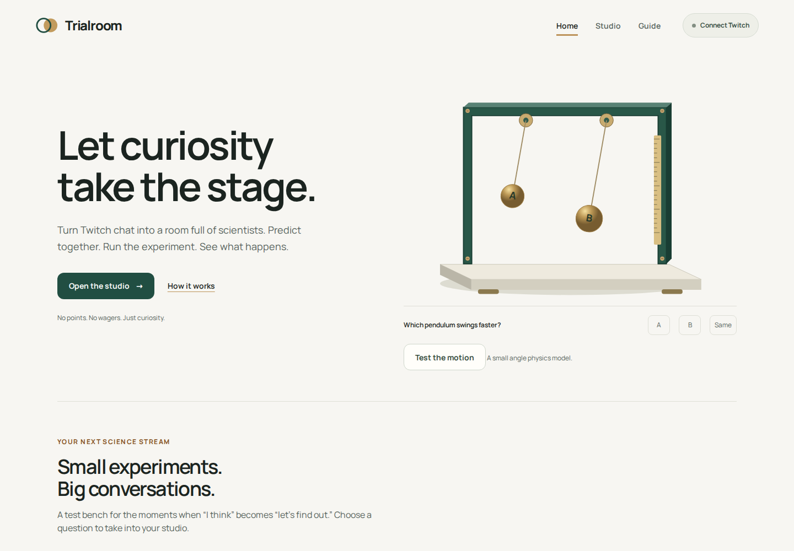
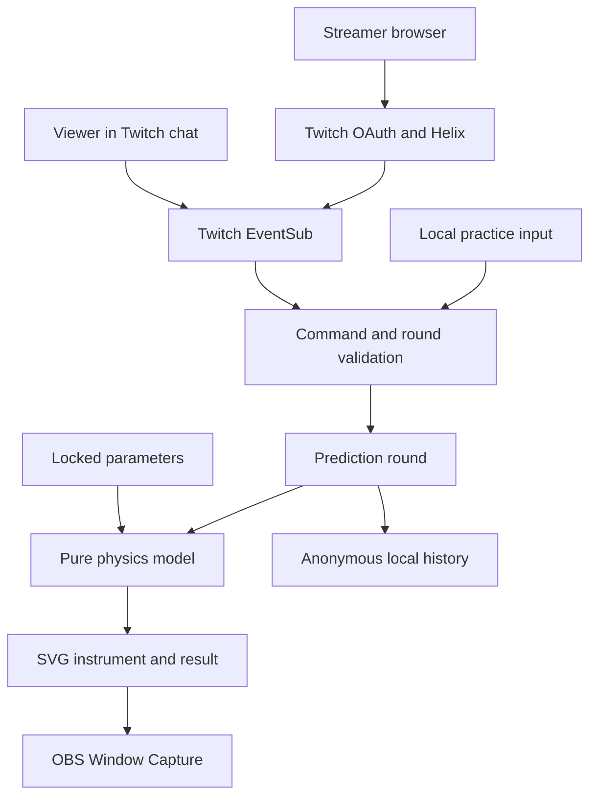

# Trialroom

**Predict. Test. Find out together.**

  

A live science studio for Twitch streamers and curious communities. Set up a physics question, collect one prediction per viewer, lock the inputs, run the model, then reveal what happened and why.

[Open the website](https://trialroom-live.vercel.app/) · [Guide](https://trialroom-live.vercel.app/#/guide) · [Validation](docs/validation.md) · [Hackathon research](docs/research.md)



## The problem and the approach

A science stream should leave room for the audience to think before an explanation arrives. Generic polls record an opinion; a physics simulator supplies a result. Trialroom puts the question, chat prediction, model and measured reveal into one reusable round. There are no points, bets, payments or generated scientific answers.

Three experiments are included:

- **The pendulum question:** vary string length and bob mass; compare small angle periods.
- **The last glide:** give two sleds the same speed and different kinetic friction; compare stopping distances.
- **Float or fall:** vary block and liquid densities; compare equilibrium outcomes, including neutral buoyancy.

The images are SVG instruments driven by the same pure model that computes the reported result. The buoyancy settling animation is illustrative; the result is an equilibrium calculation, not computational fluid dynamics.

## Try it without an account

1. Open Studio, choose a question and change the variables.
2. Select **Open predictions**, then click A, B or Same in **Local practice**. Changing a choice does not add a second viewer.
3. Close predictions, select **Run experiment**, and read the result after the eight second run.
4. Start another round. Try equal pendulum lengths with different masses, then change just one length.
5. Download the anonymous session to keep your experiments and totals. Import accepts only valid model results and replaces the saved history on this device.

Local practice is functional without Twitch credentials. Its input is labeled and is never presented as real Twitch traffic.

## Connect your Twitch channel

Live chat needs a registered Twitch app and your own Twitch authorization. **Authenticated real-channel verification is pending**; the complete browser flow is covered with controlled EventSub fixtures, which are not proof of a live channel test.

1. Sign in at [Twitch Developer Console](https://dev.twitch.tv/console/apps). Twitch requires two factor authentication to register an application.
2. Register a Website Integration app and add the exact OAuth redirect URI shown in Trialroom’s connection dialog, including the trailing slash when shown.
3. Select **Connect Twitch**, enter the application's **public Client ID**, and authorize `user:read:chat`.
4. Trialroom validates the token, opens EventSub WebSocket and subscribes to `channel.chat.message` for the authorized user's own channel.
5. Open a round. Viewers use `!trial a`, `!trial b`, or `!trial same` in the actual Twitch chat. A viewer may change their choice before the prediction window closes.

No client secret, chat write permission, server credential, paid model API or database is required. Tokens stay in browser memory/sessionStorage, are validated at connection and hourly, and are removed on disconnect. The app never posts chat messages.

If Twitch disconnects, migrates or revokes access, the current Twitch prediction window closes. Reconnect and begin a fresh round. Missed messages are not fabricated or replayed. Duplicate deliveries, stale events, unexpected subscriptions and mismatched channels cannot add votes.

## Show it on stream

Select **Stage view** in Studio and add this running browser window to OBS using **Window Capture**. Exit with the visible button or Escape. This version does not synchronize an independent OBS Browser Source: opening the site in a second browser creates a separate session. Do not put a token in an OBS URL.

## Run locally

Node.js 22 or newer:

```sh
git clone https://github.com/adeelfalaksher900-creator/trialroom.git
cd trialroom
npm ci
npm start
```

Open `http://localhost:4173/`. Set `PORT` if necessary. No `.env` is needed; public Twitch client configuration is entered in the app.

```sh
npm test                  # physics, voting, import and OAuth boundaries
npm run test:ui           # isolated browser journeys and axe checks
npm audit                 # current dependency advisories
```

`test:ui` starts and stops its own local server. It uses packaged Chromium by default. On an ordinary development machine, set `CHROME_PATH` to an installed compatible Chromium executable if needed. In this constrained cloud runtime, the package tar ownership metadata required safe extraction with no ownership changes; see the validation report. No browser certificate or web security checks were disabled.

The deployed website is static: publish the `public/` directory. `vercel.json` sets the output directory and security headers. API credentials never belong in the repository. GitHub Actions runs the model, audit and browser checks; verify the actual run status before treating it as a release gate.

## Architecture



| File | Responsibility |
| --- | --- |
| `public/physics.js` | Parameter bounds, equations, outcomes and positions |
| `public/round.js` | Round lifecycle, unique votes, deduplication and record validation |
| `public/twitch.js` | OAuth state, token validation and EventSub lifecycle |
| `public/scene.js` | Original physical SVG instruments |
| `public/app.js` | Accessible routes, controls, history and projection |
| `scripts/browser-check.cjs` | Browser interactions, protocol fixture, responsive and axe checks |

No remote database schema is needed. The local history schema is `{version: 1, rounds: [{kind, params, source, counts, outcome, at}]}`. It excludes viewer IDs, message IDs, raw chat and tokens. State is bounded to 5,000 voters and 10,000 delivery IDs per round, and 50 saved anonymous rounds. Imports are limited to 100 KB.

## Codex and the team

Created during the Codex x TwitchCon Hackathon. Codex helped research the requirements, compare ideas, implement the models and UI, diagnose the browser fetch binding error, write tests and prepare deployment and documentation. The observed build session ID and submission caveat are in [research](docs/research.md). No runtime AI is needed.

Team: **Adeel Falak Sher and Raouf Khalid**. Individual contribution roles are not invented.

## Limits and credits

Physics assumptions are visible beside the instrument and in the guide. This is not a laboratory instrument or proof of learning outcomes. Actual VoiceOver/NVDA, physical phones and an independent comprehensive penetration test have not been completed. Automated checks are bounded evidence.

Equations were checked against OpenStax University Physics, linked in the in-app sources page. Original artwork follows physical construction and motion guidance reviewed with Anatomy; no kit geometry audit is claimed. Manrope is redistributed under the included [SIL Open Font License](public/Manrope-OFL.txt). Mobbin references informed hierarchy without copying protected app assets. The [3:2 thumbnail](docs/assets/thumbnail-3x2.jpg) is an AI-assisted marketing illustration, not a screenshot of a live Twitch session.

Source: [MIT](LICENSE). Final video and 15-image gallery are deferred until the owner's review, as requested. Final Devpost submission is not performed automatically.
