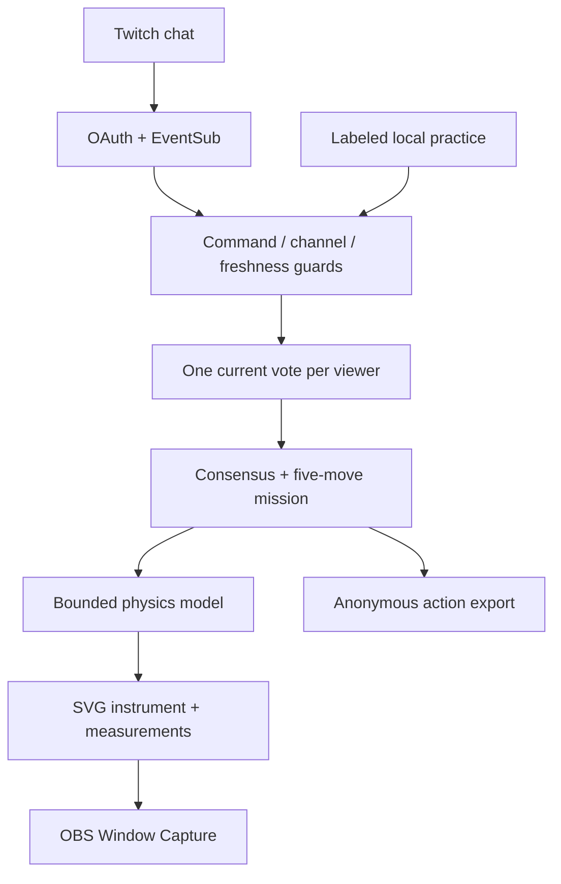

# Trialroom

**Your chat. Runs the lab.**

A cooperative physics game for Twitch. The audience has five moves to reach a shared target. Chat votes for a control; the winning action changes a real model input. The same equations drive the instrument, measurement and anonymous decision log.

[Play Trialroom](https://trialroom-live.vercel.app/#/play) · [Guide](https://trialroom-live.vercel.app/#/guide) · [Validation](docs/validation.md) · [Research](docs/research.md)


## Why it exists

A chat poll can collect opinions without giving the audience any agency. Trialroom makes the vote consequential: lengthen a pendulum, increase friction or change a block's density, then see whether the community's idea moves the experiment toward its goal. It gives science and variety creators a short cooperative segment with an explainable outcome.

This combines a target-seeking game with scientific calibration. It is not a claim to have invented collective voting, Twitch physics or cooperative puzzles. Learning outcomes and engagement gains have not been measured.

| Mission | Community goal | Controls |
| --- | --- | --- |
| Find the rhythm | Pendulum periods within 2% | Lengthen A, shorten A, add mass to A |
| Stop on the mark | Sled A stops between 1.40 and 1.70 m | Increase friction, reduce friction, increase shared speed |
| Neither float nor fall | Block B density ratio within 1% of the liquid | Reduce B density, increase B density, increase liquid density |

## Play without an account

1. Open a mission and read its target and three controls.
2. Select **Open voting**. Local practice is one voter on this device, explicitly labeled.
3. Tap A, B or C; changing your choice replaces your vote.
4. Select **Lock the vote**, then **Apply chat’s move**. Watch the four-second model run and read the result.
5. Discuss and repeat. Hit the target within five moves, or reset and try a different strategy.
6. Download the anonymous mission log to keep counts, input changes and calculated measurements.

The unique most-voted control wins. Tied or empty ballots and controls already at their bounds do not consume a move. A Twitch interruption cancels the ballot; partial votes cannot silently spend a move. Navigating away also cancels an unfinished vote. Values cannot change during voting or model execution.

### Explore freely

The [experiment studio](https://trialroom-live.vercel.app/#/studio) remains available. Set variables, collect A/B/Same predictions, run an eight-second model, reveal measurements and compare a one-variable retest. The notebook saves up to 50 anonymous rounds locally. Imports validate bounds, totals and recomputed outcomes.

## Connect Twitch

**Real-channel verification is still pending.** The owner is signed in, but Twitch rejected application creation with “user must have two factor auth enabled to perform this action.” Controlled EventSub browser fixtures verify the integration code, not a live channel session.

1. Enable two-factor authentication on your Twitch account yourself.
2. In [Twitch Developer Console](https://dev.twitch.tv/console/apps), register a **Public** client with category **Website Integration**. Add the exact OAuth redirect URI shown in the app, including a trailing slash when shown.
3. Select **Connect Twitch**, enter the application's public Client ID and authorize `user:read:chat`. Never enter a Client Secret.
4. Trialroom validates the token and subscribes to `channel.chat.message` on the authorized user's own channel through EventSub WebSocket.
5. Open voting. Viewers type `!trial a`, `!trial b` or `!trial c`. The displayed control labels define their effects. The studio also accepts `!trial same`, equivalent to C, for its equal-outcome prediction.

One current choice per Twitch user. Duplicate deliveries, old messages, wrong subscriptions and mismatched channels cannot add votes. The app never posts chat. Tokens stay in browser memory/sessionStorage, are checked on connection and hourly, and are removed on disconnect. No client secret, paid model API or database is required.

## Show it on stream

Open **Stage view** from a mission or Studio, then use **OBS Window Capture** on this running browser window. Mission stage includes the current target, instrument, remaining moves and chat commands. Host settings and account controls are hidden. Escape exits.

A separate OBS Browser Source does **not** synchronize with the host tab. Do not put a token in an OBS URL. Closing or reloading the page resets in-memory mission progress; download its log first if needed.

## Run and test locally

Node.js 22 or newer:

```sh
git clone https://github.com/adeelfalaksher900-creator/trialroom.git
cd trialroom
npm ci
npm start
```

Open `http://localhost:4173/`. Set `PORT` if required. No environment secrets are needed; public Client ID configuration is entered in the app. `.env.example` explains that boundary.

```sh
npm test
npm run test:ui
npm audit
```

The browser script starts/stops its own local server, exercises actual UI interactions, uses controlled Twitch protocol fixtures, checks responsive layouts and runs axe. Set `CHROME_PATH` for an installed compatible Chromium if necessary. In the constrained cloud environment, package tar files needed extraction with `--no-same-owner`; no certificate or web-security protections were disabled.

Deploy the `public/` directory. `vercel.json` configures static output and CSP/security headers. GitHub Actions runs tests, audit and browser checks. Protected main requires a pull request, successful `model-and-integration`, an up-to-date branch and resolved conversations; administrators cannot bypass the rule.

## Architecture



| Module | Responsibility |
| --- | --- |
| `public/game.js` | Missions, consensus, bounded actions, goals, turn history |
| `public/game-ui.js` | Play flow, control dock, mission stages, results and downloads |
| `public/home.js` | Interactive model preview and mission discovery |
| `public/physics.js` | Bounds, equations, outcomes and physical positions |
| `public/round.js` | Ballot lifecycle, deduplication and notebook import validation |
| `public/twitch.js` | OAuth state, token validation and EventSub lifecycle |
| `public/scene.js` | Original SVG instruments driven by the model |
| `public/app.js` | Routes, connection UI and free experiment studio |
| `public/inquiry.js` / `inquiry-ui.js` | Guided questions, controlled retests, traces and notebook |

No remote database is needed for this host-browser flow. A ballot holds at most 5,000 voters / 10,000 delivery IDs. Mission exports are `{format:'trialroom-mission',version:1,mission,status,moves,turns}`. Each turn includes anonymous counts, action, before/after inputs, calculated measurement and source label. User IDs, raw chat, delivery IDs and tokens are excluded. Studio JSON uses its separately validated `{version:1,rounds:[...]}` schema.

## Codex and the team

Built during the Codex x TwitchCon Hackathon. Codex supported research, product revision, models, interface, protocol integration, testing and release. The observed session ID and final-submission caveat are documented in [research](docs/research.md). There are no runtime AI requests.

Team: **Adeel Falak Sher and Raouf Khalid**. No individual contribution roles are invented.

## Limits and credits

The game uses ideal small-angle pendulums, constant kinetic friction and equilibrium buoyancy. Settling motion is illustrative, not computational fluid dynamics. Equations/assumptions and OpenStax references are visible in the app. These are calculated measurements, not sensor readings.

Mobbin's Nike Run Club and Duolingo screens were actually inspected for large-readout hierarchy, focused controls, progress and completion feedback. Trialroom uses original branding, SVG instruments, data and implementation. Manrope is bundled under its [SIL Open Font License](public/Manrope-OFL.txt); source code is [MIT](LICENSE).

Real phones, VoiceOver/NVDA and an independent comprehensive penetration test have not been completed. Automated checks are bounded engineering evidence. Final video and 15-image gallery remain deferred for the owner's review. Devpost is prepared as a draft, never automatically submitted.
