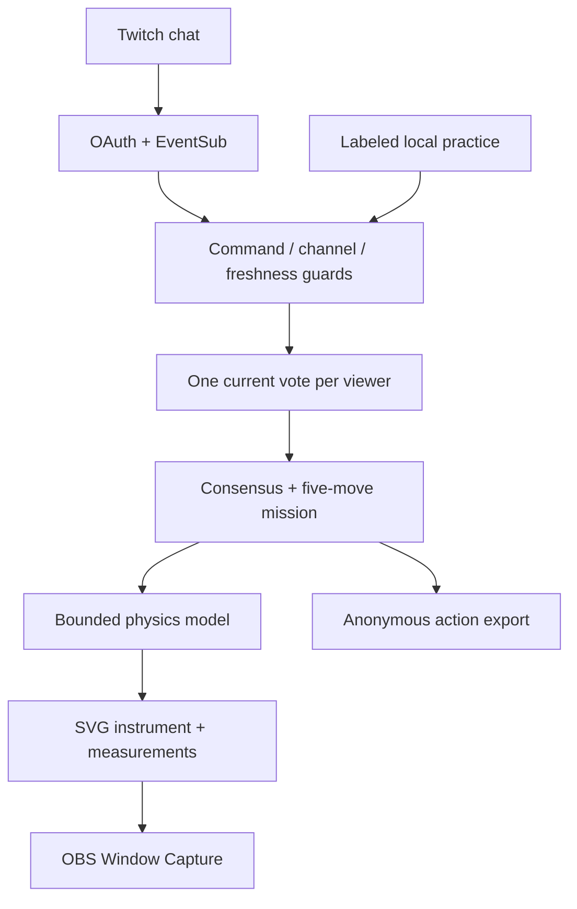

# Trialroom

**Your chat. Runs the lab.**

A cooperative physics game for Twitch. The audience has five moves to reach a shared target. Chat votes for a control; the winning action changes a real model input. The same equations drive the instrument, measurement and anonymous decision log.

[Play Trialroom](https://trialroom-live.vercel.app/#/play) · [Guide](https://trialroom-live.vercel.app/#/guide) · [Validation](docs/validation.md) · [Research](docs/research.md)


## Why it exists

A chat poll can collect opinions without giving the audience any agency. Trialroom makes the vote consequential: lengthen a pendulum, increase friction or change a block's density, then see whether the community's idea moves the experiment toward its goal. It gives science and variety creators a short cooperative segment with an explainable outcome.

This combines a target-seeking game with scientific calibration. It is not a claim to have invented collective voting, Twitch physics or cooperative puzzles. Learning outcomes and engagement gains have not been measured.

| Mission | Community goal | Controls |
| --- | --- | --- |
| Find the rhythm | Pendulum periods within 2% | Lengthen A, shorten A, add mass to A |
| Stop on the mark | Sled A stops between 1.40 and 1.70 m | Increase friction, reduce friction, increase shared speed |
| Neither float nor fall | Block B density ratio within 1% of the liquid | Reduce B density, increase B density, increase liquid density |

## Play without an account

1. Choose a mission from Discover and read its target.
2. Tap A, B or C. In solo play, one tap applies that move immediately.
3. Watch the four-second model run, read the result and choose your next move.
4. Reach the target within five moves, or reset and try a different strategy.
5. Download the anonymous action log if you want to keep your experiment trail.

**Rehearse a chat vote** lets a host try the open → vote → lock → apply flow locally. It is one practice voter, clearly labeled. With Twitch connected, the host opens voting and real chat commands choose the action instead.

Tied/empty ballots and controls already at their bounds do not consume a move. Twitch interruptions and navigation cancel an unfinished ballot. Transient voter/delivery identifiers are discarded after completed or cancelled decisions; only anonymous counts remain. They cannot reappear as local-practice votes.

### Explore freely

The [experiment studio](https://trialroom-live.vercel.app/#/studio) remains available. Set variables, collect A/B/Same predictions, run an eight-second model, reveal measurements and compare a one-variable retest. The notebook saves up to 50 anonymous rounds locally. Imports validate bounds, totals and recomputed outcomes.

## Connect Twitch

Players use **Connect Twitch → Continue with Twitch**. No developer app ID, Client Secret or password form is shown in the player dialog. The app requests only `user:read:chat` for the host's own channel and never posts messages.

**Current real-channel status:** application registration/authorization is incomplete, so the deployed player dialog truthfully offers solo play. The owner's signed-in console has no registered application, and its security page still offers Set Up Two-Factor Authentication. The integration is covered by controlled protocol/OAuth browser fixtures; those are not live Twitch evidence.

The application owner registers one Public Website Integration client, supplies its public Client ID and exact callback in `public/config.js`, and deploys. Then every host authorizes the same Trialroom application with one button. Twitch's [official registration guide](https://dev.twitch.tv/docs/authentication/register-app) explains that Client IDs are public; Client Secrets and access tokens must stay private. Never reuse another application's ID.

For local/self-hosted testing, the dedicated `#/setup` route can save an owner override on that browser. It is an owner tool, not part of player onboarding. A configured Preview with a different callback origin directs hosts to the canonical website instead of starting an OAuth flow that cannot validate its state.

One current choice per Twitch user. Viewers type `!trial a`, `!trial b` or `!trial c`; the studio also accepts `!trial same`. Duplicate deliveries, old messages, wrong subscriptions and mismatched channels cannot add votes. Tokens remain in memory/sessionStorage, are checked on connection and hourly, and are removed on disconnect. No paid inference API or database is required.

## Show it on stream

Open **Stage view** from a mission or Studio, then use **OBS Window Capture** on this running browser window. Mission stage includes the current target, instrument, remaining moves and chat commands. Host settings and account controls are hidden. Escape exits.

A separate OBS Browser Source does **not** synchronize with the host tab. Do not put a token in an OBS URL. Closing or reloading the page resets in-memory mission progress; download its log first if needed.

## Run and test locally

Node.js 22 or newer:

```sh
git clone https://github.com/adeelfalaksher900-creator/trialroom.git
cd trialroom
npm ci
npm start
```

Open `http://localhost:4173/`. Set `PORT` if required. No environment secrets are needed. The owner configures the public application identifier once; players do not enter one. `.env.example` explains that boundary.

```sh
npm test
npm run test:ui
npm audit
```

The browser script starts/stops its own local server, exercises actual UI interactions, uses controlled Twitch protocol fixtures, checks responsive layouts and runs axe. Set `CHROME_PATH` for an installed compatible Chromium if necessary. In the constrained cloud environment, package tar files needed extraction with `--no-same-owner`; no certificate or web-security protections were disabled.

Deploy the `public/` directory. `vercel.json` configures static output and CSP/security headers. GitHub Actions runs tests, audit and browser checks. Protected main requires a pull request, successful `model-and-integration`, an up-to-date branch and resolved conversations; administrators cannot bypass the rule.

## Architecture



| Module | Responsibility |
| --- | --- |
| `public/game.js` | Missions, consensus, bounded actions, goals, turn history |
| `public/game-ui.js` | Play flow, control dock, mission stages, results and downloads |
| `public/home.js` | Featured interactive experiment and illustrated mission discovery |
| `public/connection.js` / `config.js` | Shared public app configuration, player OAuth UI and separate owner setup |
| `public/playground.css` | Responsive app shell, dark surfaces, illustrated mission cards and control dock |
| `public/physics.js` | Bounds, equations, outcomes and physical positions |
| `public/round.js` | Ballot lifecycle, deduplication and notebook import validation |
| `public/twitch.js` | OAuth state, token validation and EventSub lifecycle |
| `public/scene.js` | Original SVG instruments driven by the model |
| `public/app.js` | Routes, connection UI and free experiment studio |
| `public/inquiry.js` / `inquiry-ui.js` | Guided questions, controlled retests, traces and notebook |

No remote database is needed for this host-browser flow. A ballot holds at most 5,000 voters / 10,000 delivery IDs. Mission exports are `{format:'trialroom-mission',version:1,mission,status,moves,turns}`. Each turn includes anonymous counts, action, before/after inputs, calculated measurement and source label. User IDs, raw chat, delivery IDs and tokens are excluded. Studio JSON uses its separately validated `{version:1,rounds:[...]}` schema.

## Codex and the team

Built during the Codex x TwitchCon Hackathon. Codex supported research, product revision, models, interface, protocol integration, testing and release. The observed session ID and final-submission caveat are documented in [research](docs/research.md). There are no runtime AI requests.

Team: **Adeel Falak Sher and Raouf Khalid**. No individual contribution roles are invented.

## Limits and credits

The game uses ideal small-angle pendulums, constant kinetic friction and equilibrium buoyancy. Settling motion is illustrative, not computational fluid dynamics. Equations/assumptions and OpenStax references are visible in the app. These are calculated measurements, not sensor readings.

Mobbin's Discord Discover and Twitch Browse screens were inspected for the current app shell, while earlier Nike Run Club and Duolingo references were inspected for large-readout hierarchy, focused controls, progress and completion feedback. Trialroom uses original branding, SVG instruments, data and implementation. Manrope is bundled under its [SIL Open Font License](public/Manrope-OFL.txt); source code is [MIT](LICENSE).

Real phones, VoiceOver/NVDA and an independent comprehensive penetration test have not been completed. Automated checks are bounded engineering evidence. Final video and 15-image gallery remain deferred for the owner's review. The hackathon entry remains Draft and has not been submitted. Devpost separately made the saved portfolio project public; factual submission fields are saved, while personal/legal answers and teammate membership remain for the owner.
