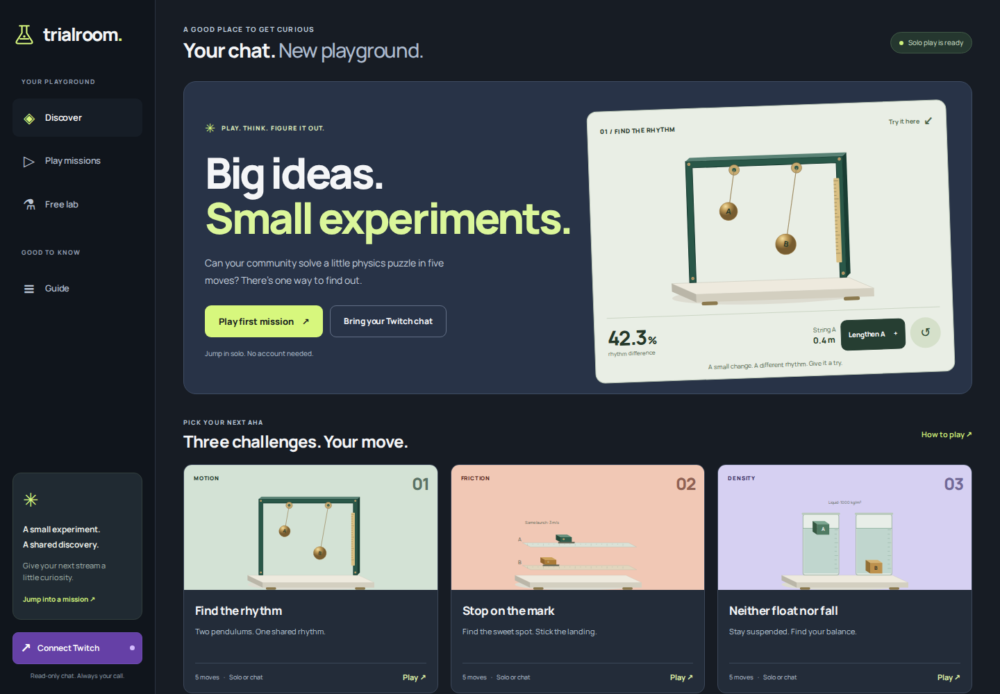
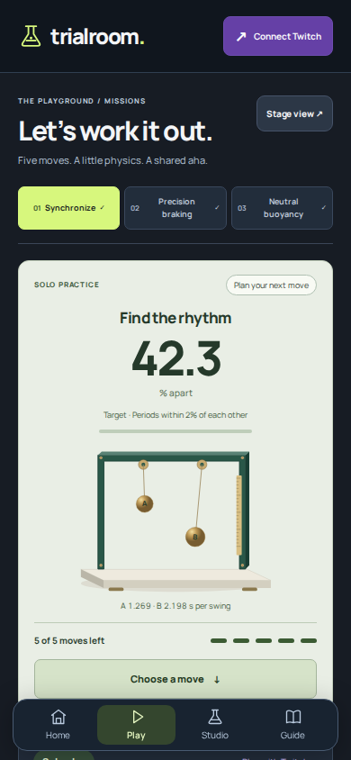
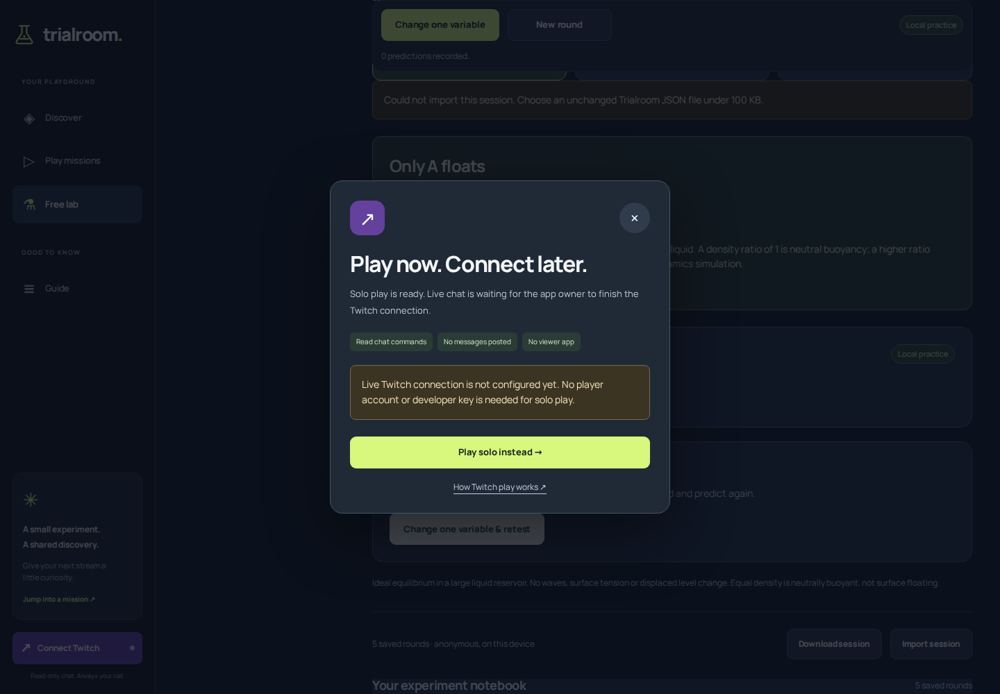
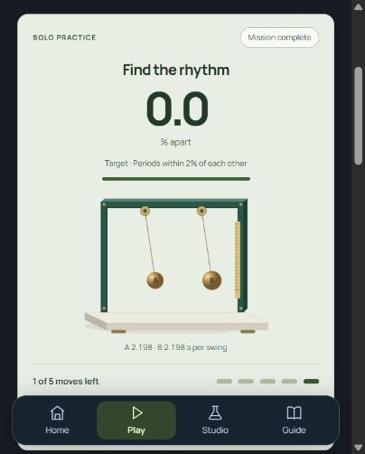

# Trialroom playground review

Reviewed November 1, 2026. This is an implementation review with actual browser evidence; it is not a prediction of winning, a learning-outcome study or an accessibility/security certification.

The redesign addresses two concrete problems: player onboarding exposed a developer Client ID form, and a solo move required opening, choosing, locking and applying a vote. Players now get a simple connection dialog. A shared app configuration drives one-button OAuth when registration is complete. Solo controls apply a move with one tap; chat-vote rehearsal is secondary.

| Step | Health | Evidence and change |
| --- | --- | --- |
| 1. Discover | Working | Compact app navigation, a featured interactive model and three distinct illustrated mission covers replace the earlier paper/green marketing layout. No unsupported game catalog or fake audience totals appear. |
| 2. Start solo | Working | Pick a target and tap a control. The model runs immediately without a multi-step voting ceremony. Mobile Choose a move scrolls to and focuses an available control. |
| 3. Solve and learn | Working | The same deterministic model drives movement, target measurement and the decision log. All three mission wins, a five-move loss and bounds are tested. A deployed Preview synchronization win required only four direct taps. |
| 4. Connect as a player | Working UI / real channel pending | No Client ID input appears in the player dialog. Configured-app browser fixtures verify one-button OAuth, read-only scope, random state and exact callback. Missing setup and Preview callback mismatch are explicit states. |
| 5. Use actual Twitch | Owner action required | The owner's console has no registered application. Application registration/authorization must finish before a real chat-controlled mission can be verified. Fixtures are never called real channel traffic. |
| 6. Keep it fair and private | Working in tests | One vote per viewer, deduplication and freshness/channel checks remain. Completed/void decisions discard voter/delivery maps. Cancelled Twitch counts cannot be presented as practice votes. Only applied anonymous totals enter the log. |
| 7. Prepare the submission | Draft, owner/media work remains | Story and factual links are saved. Personal/legal fields and teammate membership remain owner-controlled. No final submission, final video or 15-image gallery is produced. |

## Current browser captures

The first three captures below are actual local application renders from this review, not generated imagery. The final capture is an actual deployed Preview interaction.

## Mobbin references used in the implementation

[Discord Discover](https://mobbin.com/screens/3a936afb-d4c9-45c8-98cb-0f73eb0f4033), [Discord browsing](https://mobbin.com/screens/c4c78aba-8fd3-48b6-935e-466795dd6923) and [Twitch Browse](https://mobbin.com/screens/30e2787a-13f3-4cb1-9412-1b53932827bf) previews were inspected. Their coherent app-shell, featured activity and discovery-library structure informed the implementation. Trialroom has original branding, instrument artwork, model data and code. No protected game covers, logos or reference screenshots are shipped.

## Validation and judging

34 logic/protocol tests, 32 browser journeys, 72 route/width combinations and 12 axe states passed. A focused follow-up checked 16 layout combinations and the player modal after touch-target adjustments. Required CI completed successfully. No tagged automated accessibility violations were detected; eleven contrast states and five aria states remain incomplete for manual review. Dependency audit reported no known advisories.

The demonstrated distinction is target-seeking cooperative calibration: a bounded move changes a physical input and produces a reproducible measured consequence. Potential value is a short reusable segment for creators, with immediate solo onboarding and existing-chat participation. Related chat physics and cooperative voting products exist; no first-invention, adoption or engagement claim is made.

Real Twitch still requires owner setup. Physical phones, VoiceOver/NVDA, a full manual accessibility audit and comprehensive independent penetration testing remain unverified. A separate OBS Browser Source is not synchronized; use Window Capture. Full technical and release details are in [validation](validation.md).
