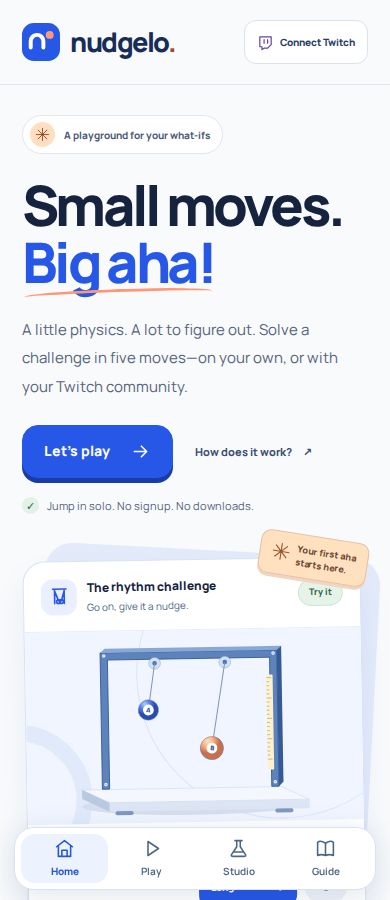
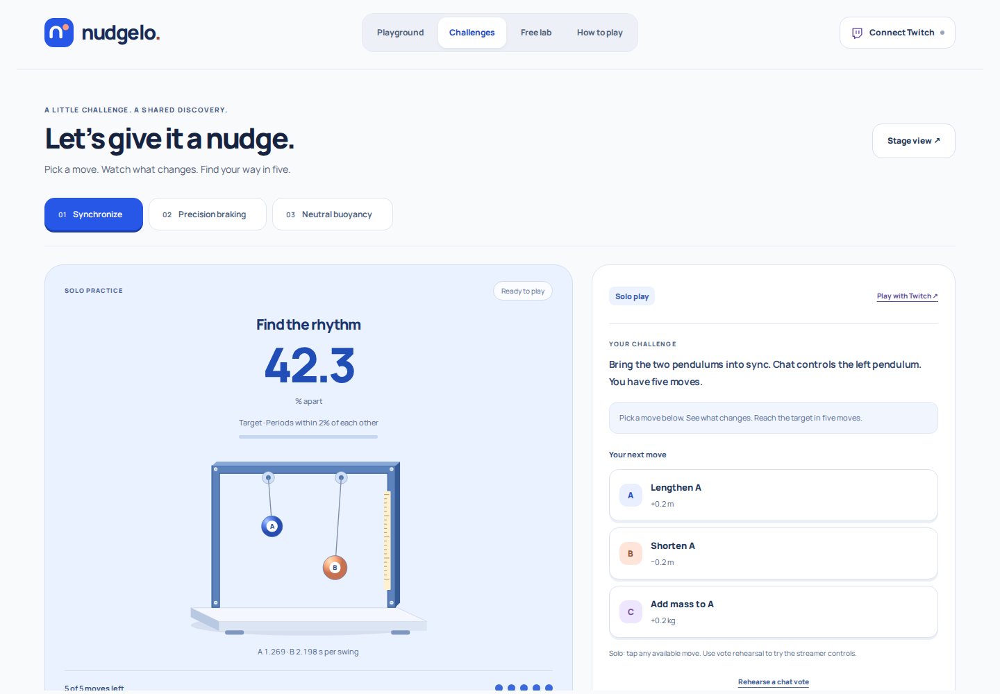

# Nudgelo design and interaction review

Reviewed November 1, 2026. The project was renamed from Trialroom to Nudgelo at the owner’s request. This is the same application and repository, not a second hackathon entry.

The new design removes the charcoal sidebar shell. A horizontal desktop navigation, pale surfaces, blue actions, colorful puzzle cards and original blue/coral instruments make the main play path clearer. On phones, the header and bottom navigation remain compact. Home starts with an actual interactive pendulum model; its length control changes both the movement and measurement.

Solo moves apply with one tap. Idle counts and chat commands are omitted from solo controls; rehearsal/live ballots and Stage view expose them. The new `!nudge` command accepts the same strict choices, while `!trial` remains supported. Session storage keys and the version-1 mission export identifier are retained for compatibility. Browser-local notebooks do not automatically move across domains.

## Actual application captures

## References inspected

Mobbin [Headspace discovery](https://mobbin.com/screens/9fb74046-d5b5-4af9-9204-78cacdd67661), [Headspace activity](https://mobbin.com/screens/1cba404f-413c-4a8b-be36-d791e9ca4fed) and [Duolingo activity](https://mobbin.com/screens/7bb8916e-d373-43c3-9614-70afaf9abfed) previews were viewed. Clear discovery, focused actions and approachable activity grouping informed the implementation. Branding, SVGs, model data and code are original. No reference screenshots or protected character assets are shipped.

## Verified scope

35 logic/protocol tests and 32 real local browser journeys passed. All 72 route/width combinations at 320–1920 CSS pixels had no horizontal overflow. Twelve axe states had zero detected tagged violations; eleven contrast states and five aria states remain incomplete for manual review. The dependency audit reported zero known advisories. The required CI and exact release identifiers are recorded in the rebrand pull request.

The review caught and fixed a phone heading overflow and insufficient contrast in secondary text, result units and studio timer labels. Pendulum labels now have opaque white backings. None of this constitutes physical-phone, VoiceOver/NVDA or comprehensive penetration-test certification.

Real Twitch remains unavailable until owner registration and host authorization are complete. The unconfigured player dialog truthfully offers solo play without a developer-ID form. The hackathon entry remains unsubmitted. Video and gallery production remain on hold. Existing thumbnail/media are not regenerated during this design revision.
