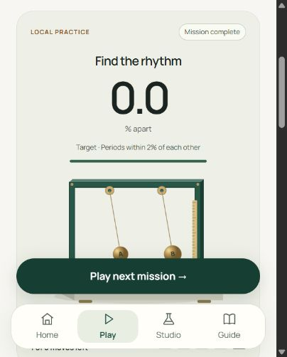
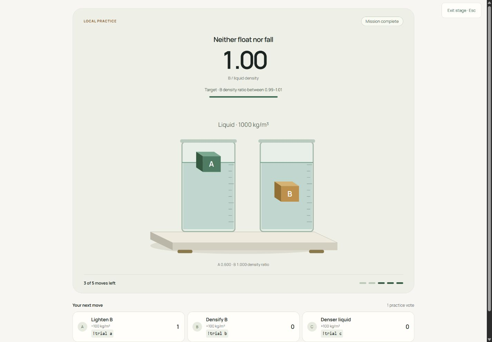

# Trialroom product review

Reviewed November 1, 2026. The revised product is a cooperative calibration game for Twitch, with the earlier experiment studio retained for free exploration. No winner score or measured engagement/learning gain is invented.

## Decision and distinction

The original studio let chat predict, but did not give it control over the experiment. The revised core makes each collective decision change one physical input. A shared target and five-move budget give the group a reason to discuss results and adjust its strategy. It is a concrete combination of scientific models and cooperative calibration, not a claim to have invented Twitch physics or group voting.

| Step | Health | Evidence and finding |
| --- | --- | --- |
| 1. Discover | Working | New Home names the audience and game, shows the five-move promise, provides a primary mission action and has an actual length-control preview. |
| 2. Understand target | Working | Play shows one large measured value, target tolerance, original instrument and moves remaining. A/B/C controls show their exact physical effects and commands. |
| 3. Vote | Working locally / protocol fixtures | One current vote per viewer; changed choices replace votes. Inputs and mission switches lock during a ballot. Empty/tied votes and at-bound controls spend no move. |
| 4. Apply and learn | Working on Preview and Production | A chosen action changes one bounded input, then the same model animates and measures it. Three missions have verified wins; ineffective mass changes produce a real five-move loss. |
| 5. Keep and share | Working | Anonymous action downloads reproduce input changes. Stage view keeps commands and the target visible while hiding host settings. A separate OBS Browser Source is not synchronized. |
| 6. Connect actual Twitch | Owner action required | Signed-in console rejected application creation until owner 2FA is enabled. Actual authorization and chat traffic remain unverified. |
| 7. Prepare submission | Saved, incomplete owner/media steps | Story, factual answers and links are saved. Hackathon entry remains Draft. Personal/legal fields, teammate membership and real Twitch/video evidence remain. |

## Current captures

These captures were produced in this review run. The first three come from actual automated local UI interactions; the last two are real deployed browser interactions.

## References and resulting design

Fresh Mobbin [Nike Run Club active run](https://mobbin.com/screens/13ac4d1d-b7c8-449b-8a5e-5be954efb76d), [run controls](https://mobbin.com/screens/95915ab3-c112-4ff6-9644-350b37c7a1a7) and [Duolingo story completion](https://mobbin.com/flows/1ff832eb-e370-438f-960e-b19609d66685) previews were inspected. The implementation follows a coherent large metric → focused canvas → control dock hierarchy, with visible progress and completion feedback. Trialroom's instrument artwork, data, palette, branding and code are original.

Mobile inspection exposed a primary action below the fold. It now stays above the bottom navigation; opening a vote brings controls into view and applying it returns to the instrument. Textual states and commands remain available with reduced motion. Small text and incomplete automated contrast checks still warrant manual/assistive-technology review.

## Judging evidence

| Criterion | Demonstrable strength | Limit |
| --- | --- | --- |
| Innovation/Idea | Audience actions pursue physical targets, with bounded moves and a reproducible experimental trail. | Related cooperative games and chat physics exist. |
| Potential Impact | A reusable short segment for science/variety creators, with no viewer app or paid inference requirement. | No creator study, adoption result or learning gain has been measured. |
| Technological implementation | Deterministic models, explicit state transitions, guarded EventSub adapter, tested UI and protected CI/release. Codex use is documented. | An actual Twitch mission is blocked by owner 2FA. |
| Design | Consistent original instrument system, readable targets, mobile control access, mission progress and honest states. | Real phones, VoiceOver/NVDA and manual accessibility completion remain pending. |

26 Node tests, 25 browser journeys, 64 layout combinations and 12 axe states passed; incomplete accessibility findings are retained. [Validation](validation.md) distinguishes local/CI, deployed browser interactions, protocol fixtures and failed terminal network probes. This review does not constitute comprehensive penetration testing or accessibility certification.
