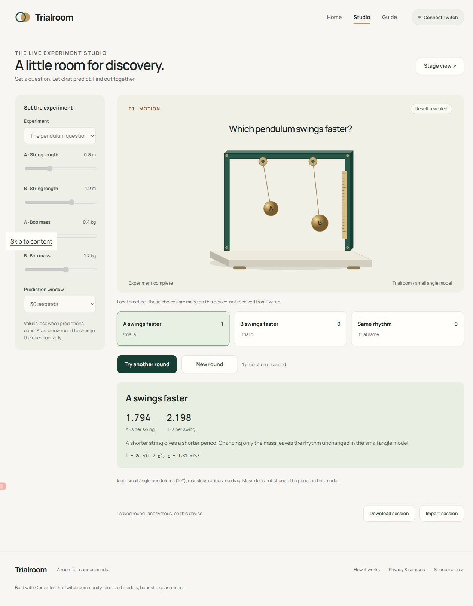
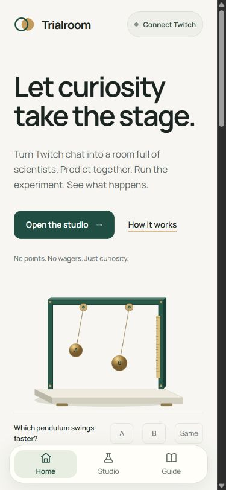
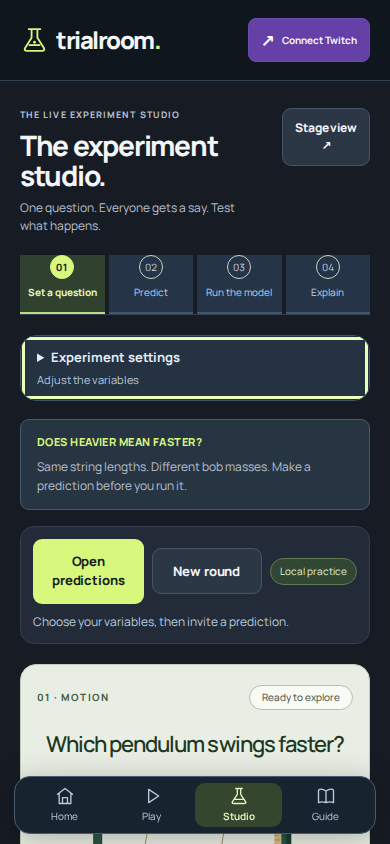
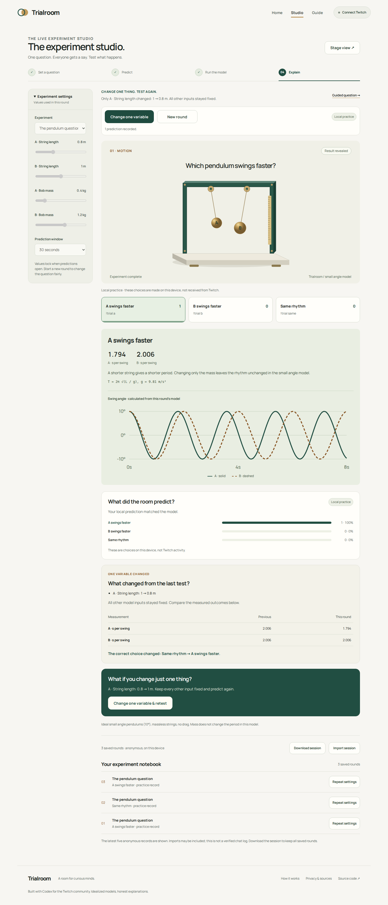
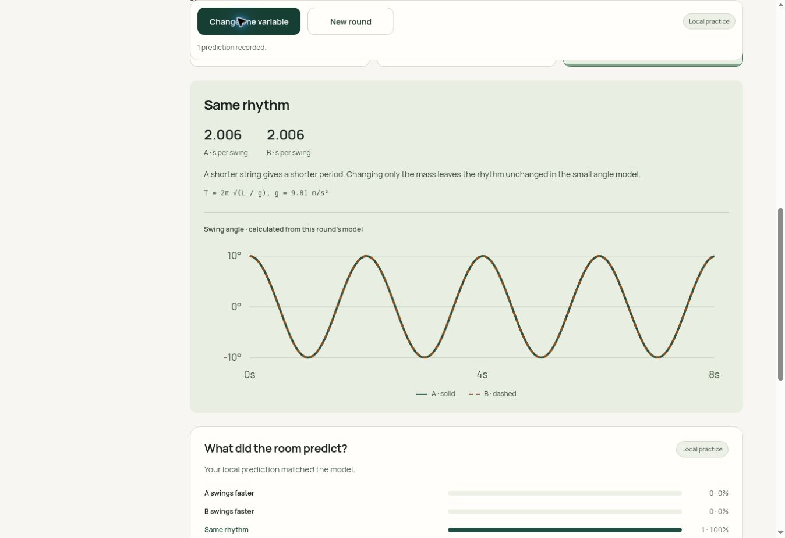
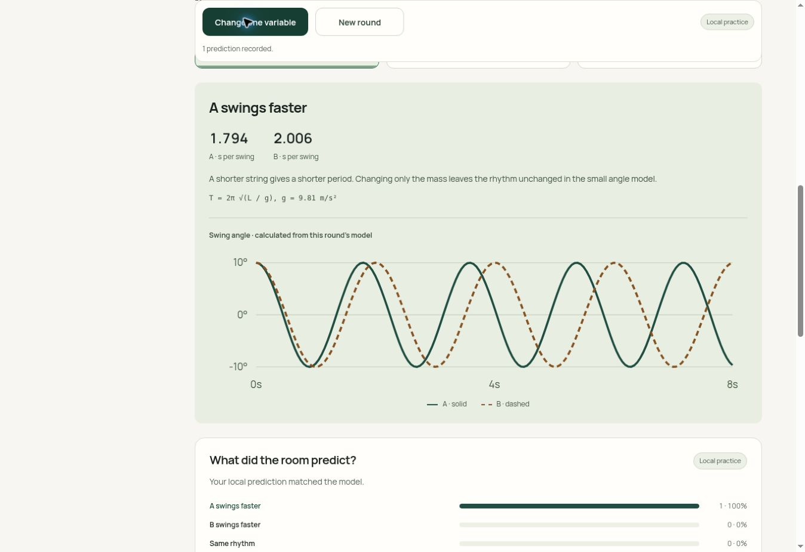
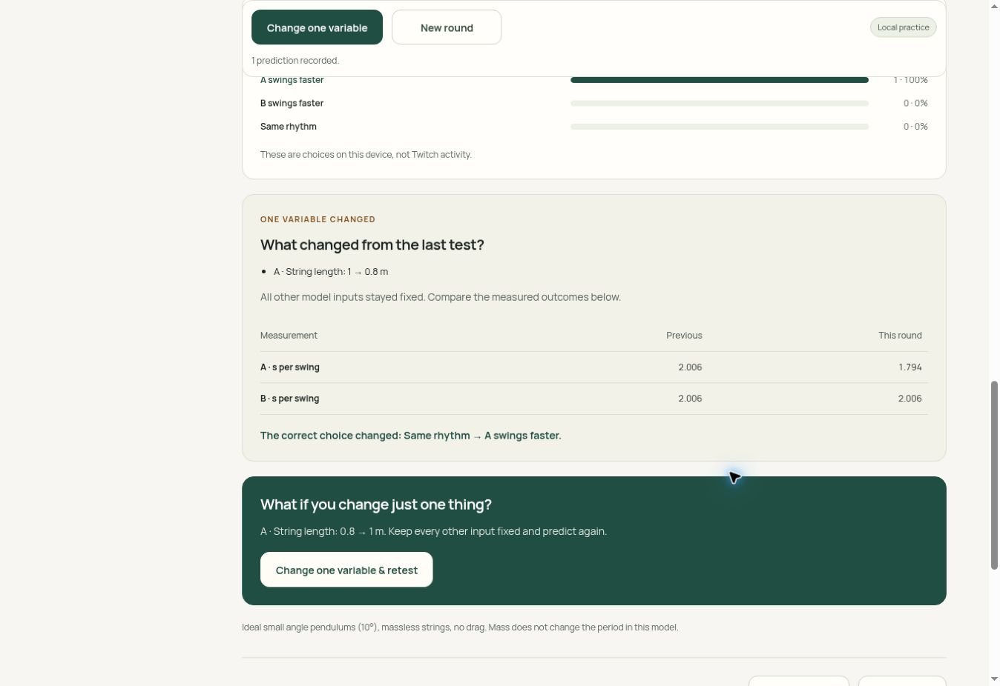

# Trialroom product review

Reviewed November 1, 2026 for the Codex x TwitchCon Hackathon. This review uses fresh captures and actual browser interactions in this review run. It is not a prediction of winning or a claim of measured learning impact.

## Product decision

Keep Trialroom and strengthen its central interaction: a science streamer poses a testable question, chat commits to a prediction, a deterministic model provides a measured reveal, and the host changes one variable to investigate further. The strongest demonstration is the guided mass question: equal pendulum lengths and different masses produce the same 2.006-second period; shortening only A's string to 0.8 m changes its period to 1.794 seconds while B stays at 2.006 seconds. Those values are calculated model outputs, not sensor readings or user-study results.

A remote database is unnecessary for this journey. Twitch OAuth/EventSub runs in the host browser; anonymous records stay on the device. A separate multi-device synchronized room would need additional infrastructure and is not represented as implemented.

## Flow review and changes

| Step | User interaction and health | Evidence and resulting change |
| --- | --- | --- |
| 1 | Home: improved entry clarity | The original mobile screen led with general curiosity copy. The revised screen names Twitch science experiments, explains prediction → test → repeat and provides a guided starting action. Its Home prediction buttons now work. |
| 2 | Guided question: verified locally | A predefined question isolates mass while holding string lengths equal. Progress shows Set a question, Predict, Run the model and Explain. The settings disclosure opens/closes with the keyboard and folds away on mobile. |
| 3 | Predictions: verified locally and with controlled protocol fixtures | Values lock, one voter changes an existing choice, duplicate deliveries do not add votes and connection loss closes predictions. A visible input-mode label distinguishes local practice from Twitch input. Fresh mobile inspection showed the primary action below the fold; controls were moved beside the question with sticky positioning. |
| 4 | Run and explain: verified locally | Original SVG instruments actually move. Calculated traces, measurement values, assumptions and prediction totals explain the result. No-prediction rounds are distinguished from a real zero-percent correct outcome. |
| 5 | Retest: verified locally | Exactly one bounded value changes. A before/after table uses the actual previous round. More than one changed value is explicitly identified instead of being called a controlled comparison. |
| 6 | Notebook: verified locally | The latest five anonymous saved records are visible. Repeat settings restores parameters with fresh predictions. Import/export keeps identities and tokens out. Imported records are not represented as verified chat logs. |
| 7 | Authenticated Twitch participation: blocked on owner access | The existing Twitch tab shows its username/password form. A real client registration, owner OAuth and actual chat round remain necessary. Fixtures establish protocol behavior, not a live Twitch test. |

### Captured evidence

Original studio, captured in the connected Chrome browser during this review:

Original mobile Home, captured in the connected Chrome browser during this review:

Revised mobile studio with visible controls, captured by the actual automated Chromium journey:

The new result and controlled comparison, captured by the actual automated Chromium journey:

## Design references actually inspected

Mobbin's [Brilliant lesson](https://mobbin.com/screens/0806e864-e953-46f7-8410-7ea00e69aac7), [Brilliant completed state](https://mobbin.com/screens/ad8e0fa1-5d4f-4b8f-8037-9b5cb3b23cf3) and [Teams response totals](https://mobbin.com/screens/0385434b-1a69-4cb1-b02d-9d0e213405b7) informed single-question focus, visible progress, the next action and readable distributions. Trialroom's artwork, model plots, palette and implementation are original. No protected reference asset or complete app design was copied.

## Judging evidence, without a fabricated score

The official Devpost criteria were retrieved again during this review: Innovation/Idea, Potential Impact, Technological implementation and Design. They use a five-point scale; no self-assigned winner score is reported.

| Criterion | Demonstrable evidence | Remaining limit |
| --- | --- | --- |
| Innovation/Idea | Prediction, calculated physical model and controlled retest form one reusable science-stream interaction. | This is a differentiated combination, not a claim to be the world's first simulator or Twitch poll. |
| Potential Impact | Hosts get a prepared interactive science segment; viewers can form and revisit a hypothesis through chat commands. | Learning outcomes, creator adoption and engagement improvement have not been measured. |
| Technological implementation | Pure model and state modules, deduplication, bounded imports, browser OAuth/EventSub, calculated plots and reproducible tests. Codex work is documented. | Authenticated Twitch still needs owner sign-in and a real round. |
| Design | Original animated instruments, responsive layouts, visible progress, clear input mode, keyboard controls and reduced motion. | Automated accessibility has incomplete items; real assistive technology and physical phones remain untested. |

## Current verification

17 unit tests and 15 browser journeys pass. Forty route/width combinations have no document horizontal overflow. Eight axe states have no detected WCAG-tagged violations, with incomplete checks retained. Dependency audit reports zero known advisories. The keyboard skip-link routing bug was first reproduced by a failing browser assertion and then fixed and retested.

The source, [browser report](browser-report.json), [validation record](validation.md) and setup instructions describe the limits. This is bounded testing, not comprehensive penetration testing, full accessibility certification or proof of a functioning authenticated Twitch session. Final video and the 15-image gallery remain deferred until the owner's project review.

## Independently verified live flow

The released canonical website was opened in an independent cloud browser. Steps 1–6 were exercised through a complete two-round local practice sequence: guided setup, prediction, lock, run, reveal, one-variable retest, actual before/after measurements, anonymous download and notebook restore. The public deployment's 13 files also exactly matched the tested source over HTTPS. This verifies local practice on Production, not authenticated Twitch participation.

